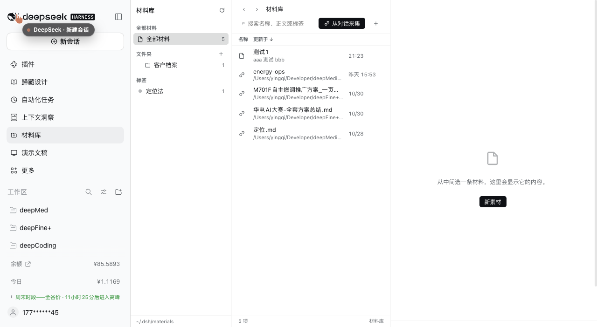
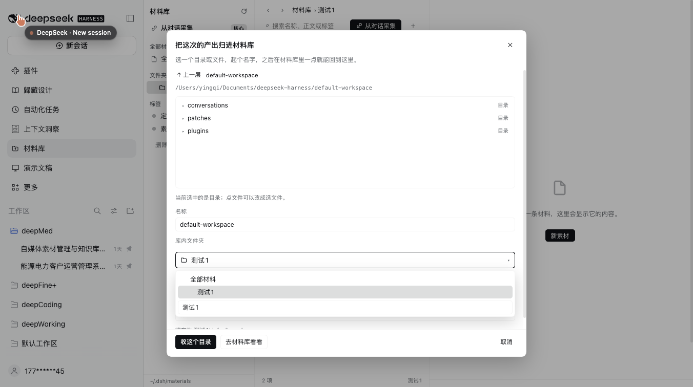

# dsh-material-library

A material library for [DeepSeek Harness](https://github.com/deepseek-ai/deepseek-harness) (`dsh`): collect what a conversation produced — a folder, a file, a note — keep it in real folders with tags, and jump back to the chat it came from in one click.



[中文说明](#中文说明)

## What it does

- **Collect from a conversation.** A button in the session header and a `从对话采集 / Collect from chat` button in the library open a picker: choose a conversation, browse its working directory, pick a folder or a file, name the entry, choose the library folder and tags. Entries point at the original path; nothing is copied.
- **Real folders, real files.** A note is a `.md` file on disk; the folder tree *is* the directory tree under the library root (default `~/.dsh/materials`). Tags live in `.index.json` beside it. You can edit either from outside the app.
- **Finder-like browsing.** Source list (all materials / folders / tags) · list view with name, updated, folder and tags · detail pane with a file card, a default-app button and an "open with…" menu.
- **Open with…** runs the macOS `open` command: the default app, or another installed application picked from a menu, or reveal in Finder. Images preview inline; text and Markdown render in the detail pane.
- **Read like a chat.** Markdown is rendered with the typography of conversation messages — headings, nested lists, quotes, code blocks, tables, rules — including when the entry is a reference to a file outside the library.
- **Reopen the source.** For a collected entry, `Open in original session` switches to that conversation and opens the folder in its right sidebar.
- **Everything is editable.** Rename or delete a folder or tag from the sidebar (a tag rename rewrites it everywhere; a folder rename moves its files), edit name/folder/tags of any entry, search names, bodies and tags.
- **Version history.** Every save keeps the previous body under `.history/` (up to 30 per file). Open `Versions` in the detail header, read any version in the pane, and restore it — restoring snapshots the current body first, so a restore is undoable. Notes kept: refs and folders have no versions.
- **Copy a reference into the library.** A collected entry can be turned into a real file inside the library (`收进库 / Copy into library`); the original is untouched.
- **Import a tree.** `/import` copies a file or a directory from anywhere inside your home directory into the library (up to 2000 files per call), reusing the same collision-safe naming.



## Install

```sh
dsh plugin --profile <your-profile> add dsh-material-library
```

Published on npm as [`dsh-material-library`](https://www.npmjs.com/package/dsh-material-library); installing straight from GitHub also works: `dsh plugin --profile <your-profile> add github:yingqi-studio/dsh-material-library`.

In DSH Desktop, open **Plugins**, search the name, and install it there. Restart `dsh web` (or refresh the page) and the library appears as an icon in the sidebar.

Requires a host with the sidebar-entry and right-sidebar slots (`dsh.web` 0.2.x). `engines.dsh` is declared as `>=0.2.0`.

## Where things are stored

```
~/.dsh/materials/            # library root (override with the plugin config `root`)
├── .index.json              # tags for notes, plus the references you collected
├── 使用说明.md               # a note = a real markdown file
└── 客户项目/                 # a folder = a real folder
    └── 需求.md
```

Set `root` in the plugin config to move the library elsewhere. Writes are serialized and atomic (`.tmp` + rename); paths are confined to the library root, and collected targets must stay inside your home directory.

## HTTP API

The UI talks to the host over same-origin JSON routes under `/api/dsh-materials` (no generated remotes, so it stays dependency-free):

| Method | Route | Purpose |
| --- | --- | --- |
| GET | `/health` | library root, readiness |
| GET | `/home` | home directory (fallback start for the picker) |
| GET | `/state` | folders, notes, references, tag counts |
| GET | `/list?path=` | list a directory outside the library (for the picker) |
| GET | `/file?path=` | read a note |
| GET | `/ref/preview?id=` | read a referenced text file for the detail pane |
| GET | `/ref/raw?id=` | raw bytes of a referenced file (images) |
| GET | `/openers?path=` | installed apps that can open a target, with icons |
| GET | `/search?q=&tag=` | search names, bodies and tags |
| GET | `/session-times` | last-modified time per session (picker ordering) |
| POST | `/create` `/update` `/delete` | notes |
| POST | `/folder` `/folder/rename` `/folder/delete` | folders |
| POST | `/tag/rename` `/tag/delete` | tags |
| POST | `/ref/add` `/ref/update` `/ref/delete` | collected references |
| POST | `/open` | open / reveal a target with the OS |
| GET | `/versions?path=` | saved versions of a note (id, time, size) |
| GET | `/version?path=&id=` | read one saved version |
| POST | `/restore` | restore a version (snapshots the current body first) |
| POST | `/ref/copy` | copy a collected reference into the library as a real file |
| POST | `/import` | copy a file or directory from inside the home directory into the library |
| POST | `/archive` | file files or a folder into the library as references (idempotent; merges tags on a path already filed) |

Everything that mutates goes through one serialized store; conflicts (duplicate name, non-empty folder, unknown application) come back as readable 4xx errors.

## Agent tool: materials_archive

A scheduled task can file its own output. The host registers one tool, `materials_archive`, available in every session:

```
materials_archive(path="out/", folder="日报/2026-11", tags=["日报"], include=".html,.md")
```

- `path` — file or folder (supports `~`; a relative path resolves against the session's working directory). Omitted: the working directory.
- `folder` — library folder; empty/omitted files at the root. Created on demand.
- `tags` — merged with whatever the entry already carries.
- `depth` — `1` (default) files the files directly inside a folder, `0` files the folder itself as one entry, up to `12`.
- `include` — comma separated suffix/glob filter, e.g. `.html,.jpg` or `*.png`.
- `limit` — stop after N entries (default 50, max 200).

It is idempotent per path: filing the same path again refreshes its tags and folder instead of adding a second entry, so a task that runs every day can just call it again. The files are never moved or copied — the entry is a reference.

**For a scheduled task**, end the task prompt with a line like:

> 跑完把 out/ 收进材料库，folder 用「日报/当月」，tags 用 ["日报"]。

## Notes and limits

- A collected entry is a **reference**, not a copy: if the original moves, the entry shows as missing.
- Only targets inside your home directory can be collected.
- Files you drop into the library by hand are listed but have no tags until you tag them in the UI.
- The Markdown renderer is built in (~150 lines, no dependency): it covers common syntax but not inline HTML, footnotes or task-list checkboxes.
- Versions exist for notes, not for references or folders.
- `materials_archive` files **references**, so a re-run of a task that overwrites its output still points at the same (new) file; a task that writes a new timestamped file every run adds one entry per run.

## 中文说明

把对话里产出的目录、文件和笔记收进一个材料库：真实文件夹 + 标签，Finder 的观感，点开像对话消息一样阅读，一键跳回原始会话。

- **从对话采集**：会话标题栏按钮 / 库内「从对话采集」按钮 → 选对话、浏览目录、选文件或目录、起名、选库内文件夹与标签。收进来的是**引用**，原文件不动。
- **真实目录**：笔记就是磁盘上的 `.md`，文件夹就是目录树（默认 `~/.dsh/materials`），标签存在 `.index.json`。
- **三栏浏览**：左栏 全部材料 / 文件夹 / 标签；中栏列表（名称、更新、文件夹、标签）；右栏文件卡 + 默认应用 + 「打开方式」菜单。
- **打开方式**：默认应用 / 其它已安装应用 / 在 Finder 中显示；图片行内预览，文本与 Markdown 在右栏渲染。
- **像对话一样阅读**：标题、嵌套列表、引用、代码块、表格、分隔线，引用外部文件时同样渲染。
- **在原始会话右侧打开**：切回那个对话并打开右侧文件面板。
- **都能改**：文件夹、标签可就地改名或删除（标签改名全库生效、文件夹改名带走文件），条目的名称/文件夹/标签可编辑。
- **历史版本**：每次保存都把上一版留在 `.history/`（每个文件最多 30 份）；右栏头部「历史版本」→ 选中看正文 → 「恢复这个版本」。恢复前会先给当前内容拍一份快照，所以恢复本身也能撤回。
- **收进库**：引用型条目可以复制成库里的真实文件，原件不动。
- **导入**：`/import` 把 home 目录里的一个文件或一整个目录复制进库（单次上限 2000 个文件）。
- **给 agent 的工具 `materials_archive`**：定时任务可以自己把产出收进库。任务 prompt 末尾加一句「跑完把 out/ 收进材料库，folder 用日报/当月，tags 用 ["日报"]」即可；同一条路径重复归档只更新标签与文件夹，不会重复入库，原件不动。

安装：`dsh plugin --profile <profile> add dsh-material-library`（未发布 npm 时用 `github:yingqi-studio/dsh-material-library`）。

## License

MIT
